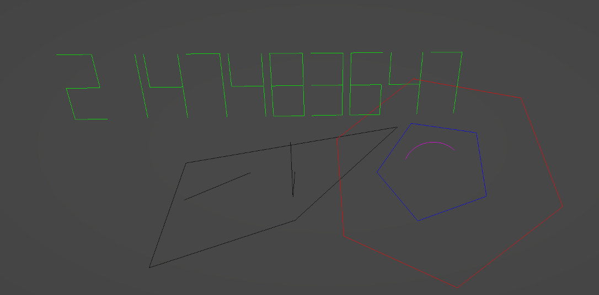
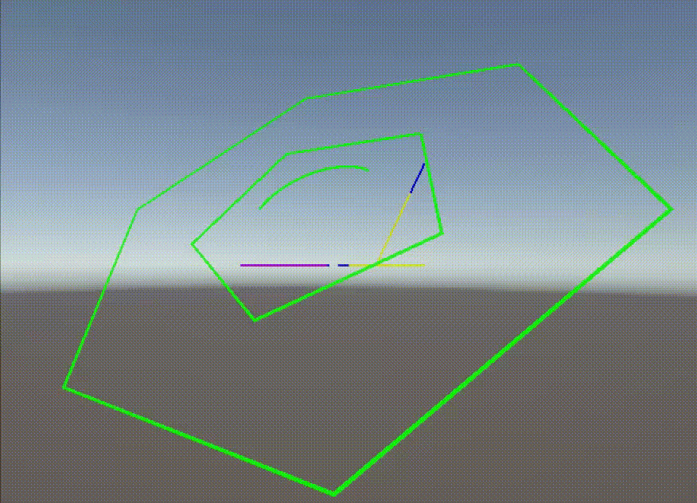

# Gizmos Extensions

A small unity package increasing the number of gizmos avalable for development




## Instalation
In the package manager go to install package from git URL... and paste the following:

`https://github.com/3NDavis/SharedValues.git?path=./`

## Contents
Editor Gizmos:
- Integers
- Shapes
    - Rectangle
    - Triangle
    - Pentagon
    - Hexagon
    - Circle
- Lines
    - Arrow
    - Arc
    - Multisegment Line

Runtime Gizmos:
- Shapes
- Default lines
- Multisegment lines
- Progress Lines

## Usage
### Editor
If you are using assembly definition assets, make sure you have the assembly referenced.

Editor functionality should be pretty similar to the already exhisting gizmos systems

``` CSharp
using GizmosExtensions;

public void OnDrawGizmos
{
    //if one side == 0 and opposite is > 0 you draw a triangle
    Debug.DrawRectangle(position, rotation, topLength, bottomLength, leftLenght, rightLength, Color.purple);
    
    Debug.DrawHexagon(position, rotation, radius, Color.red);
    
    Debug.DrawArc(position, rotation, radius, arcLengthDegrees, quality, Color.magenta);
    
    Debug.DrawNumber(position, number, Color.green);
}
```

### Runtime
#### How it works
Runtime gizmos requires the `RuntimeGizmos` script to be present and configured in the scene. It acts as the manager and object pooler so there is not a rediculous number of objects being created/destroyed every frame.

The runtime gizmos themselves are LineRenderers

The runtime manager will clear the gizmos *every frame* in `Update()` to prevent parity bugs it is reccomended that you use `LateUpdate()` for any RuntimeGizmos


#### Setup

You will need to reference the `GizmosExtensions.RuntimeGizmos` if you wish to use runtime gizmos.

You will also need to add `USE_RUNTIME_GIZMOS` to you scripting defines in the player settings

#### Scripting

To create a runtime gizmo you will need to generate an array of points that the runtime gizmo manager will populate the linerender(s) with. You will have to use `new GizmoLine(parameters)`

##### The GizmoLine Class
The gizmo line class lets passes in:
- draw progress
- color
- future color (for draw progress)
- points

The `points` are the only mandatory value to set.

##### Example
``` CSharp
using GizmosExtensions;
using GizmosExtensions.RuntimeGizmos;

public void LateUpdate()
{
    RuntimeGizmos.DrawLine(new GizmoLine(line.drawProgress, line.color, line.points));

    RuntimeGizmos.DrawLine(new GizmoLine(Debug.GetArcPoints(position, rotation, radius, quality, arclength)));
}
```
